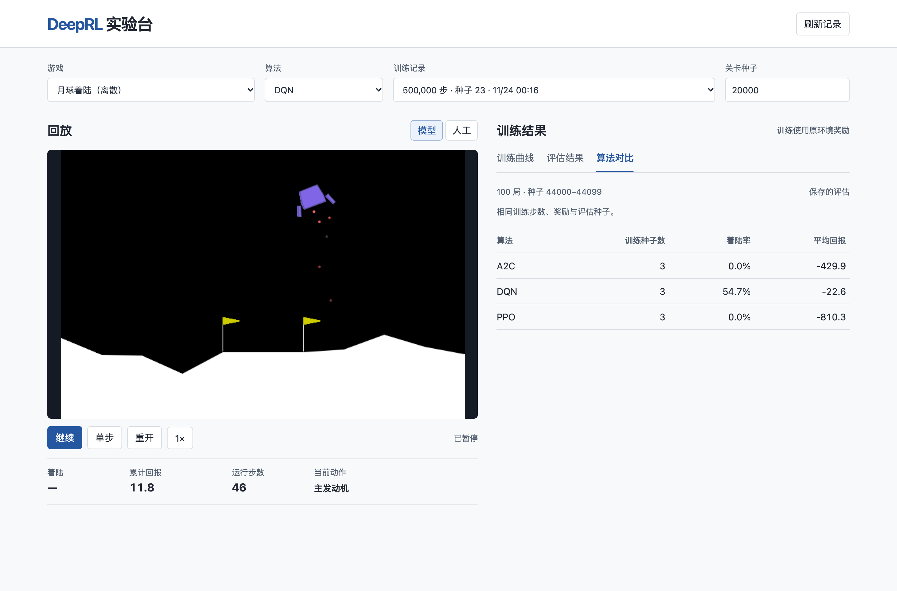

# 校内外实习报告（3）｜基于深度强化学习的简单游戏智能控制——系统实现

## 1 开发工具与环境搭建

本项目以贪吃蛇、Flappy Bird 和 Lunar Lander 为控制任务。贪吃蛇由项目实现游戏规则，Flappy Bird 接入第三方环境，月球着陆接入 Gymnasium 的离散和连续两个版本。四种环境共用训练、评估、模型回放和结果展示流程。三款游戏都使用数值观测，界面显示的图像用于观察动作及其后果。训练在无窗口模式下运行，只有人工试玩或模型回放需要渲染。

项目采用 Python 编写，在 Apple Silicon Mac 的现有 Conda 环境 `DRL` 中运行。核对时的 Python 版本为 3.11.16，PyTorch 为 2.14.0，NumPy 为 2.4.6，Gymnasium 为 1.3.0，Pygame 为 2.6.1。Flappy Bird 适配对应 `flappy-bird-gymnasium 0.4.0`，月球着陆的物理仿真依赖 `Box2D 2.3.10`。现有训练记录使用 CPU。当前网络输入是几十至百余个数值，训练又需要反复在 Python 中推进游戏。一套已验证的 CPU 环境能让不同任务共用运行方式，也省去了额外的设备适配。

Gymnasium 统一观测、动作、重置和单步交互接口。PyTorch 用于搭建策略和价值网络、计算损失、更新参数并保存权重。NumPy 处理棋盘编码、采样和部分统计。Pygame 提供桌面窗口及离屏画面。网页实验台借助 Python 标准库提供本地服务，前端用 HTML、CSS 和 JavaScript 显示画面和训练结果。数据保存采用 JSON、CSV 和 PyTorch 权重文件，逐局记录可以直接打开检查，也能由界面重复读取。

从项目根目录进入现有的 `DRL` 环境后，可运行以下命令验证主要入口。训练命令会产生一次新的运行记录。

```bash
conda activate DRL
python -m unittest discover -s tests -v
python run.py play --game snake
python run.py web
# 需要重新训练时执行
python run.py train --game snake --algorithm dqn --steps 50000 --seed 42
```

桌面模式适合直接体验手动控制，网页模式在浏览器打开 `http://127.0.0.1:8000` 后即可访问。具体运行文件见项目的[使用说明](../README.md)。

## 2 系统详细设计与实现

### 2.1 模块组织及数据流

项目通过 `run.py` 接收游戏、算法、训练步数和种子等参数。代码按照职责拆分。环境负责执行规则和返回反馈，算法负责选择动作和更新参数，实验入口串起采样和存档，界面把已有控制器和运行记录呈现出来。接入新环境时，先核对观测维度、动作空间、得分定义和结束标志，再决定哪些算法可以复用。连续环境若选择 DQN、PPO 或 A2C，入口会报错，因为当前这三种实现在离散动作空间中工作。

| 模块 | 主要位置 | 数据流 |
|---|---|---|
| 游戏环境 | `games/` | 接收动作，返回观测、奖励、结束标志与辅助信息 |
| 学习算法 | `algorithm/` | 从观测生成动作，用转移或轨迹更新网络 |
| 训练与评估 | `experiments/` | 建立环境和模型，记录回合，保存或加载权重 |
| 桌面和网页实验台 | `ui/` | 处理键盘及回放操作，从本地读取模型和 CSV |
| 自动化测试 | `tests/` | 校验游戏规则、数值计算、短训和交互 |

环境的 `reset(seed=...)` 返回初始观测和辅助信息，`step(action)` 则返回下一观测、奖励、自然终止、时间截断与辅助信息。碰撞等游戏事件会自然终止回合。触及步数上限会截断回合，但最后一个观测仍然有意义，算法可用它估计后续价值。两种情况都会重开一局，更新时用不同的掩码处理。累计奖励用于解释策略的优化目标，得分用于解释游戏结果，二者各自写入日志。

### 2.2 游戏规则与环境适配

贪吃蛇使用 10×10 棋盘。重置后蛇头位于固定位置，食物从空格中随机生成。109 维观测由 100 个棋盘编码、4 个朝向分量、3 个候选动作的碰撞提示及 2 个归一化食物偏移分量组成。棋盘上的蛇身格保留身体顺序，尾部位置因此能够从数值中识别。三个动作分别为直行、相对左转和相对右转。食物被吃到时加一分，环境奖励为 +1，蛇增长一节。撞墙或撞身时奖励为 −1，普通移动为 0。吃满棋盘也结束回合。外部时间限制为 300 步。

贪吃蛇检查碰撞时要考虑尾部与蛇头在同一步内的变化。普通移动会腾出旧尾格，因此蛇头走进该格可以继续，本步增长时尾巴保留。实现先判断目标格和食物的关系，再确定哪些身体格参与判定。若把整条蛇身一律视为障碍，会误判贴尾移动，碰撞提示也随之错误。人工操控时，方向键按屏幕上的绝对方向解释，再根据当前朝向换算成环境动作。这样既保留了三动作定义，玩家也可以按习惯用上下左右控制。

Flappy Bird 使用第三方 `FlappyBird-v0`，关闭激光测距观测，保留 12 维数值输入。拍翅和保持是两个离散动作，默认每局最多 3600 步。环境适配将观测和空间声明都转换成 `float32`，避免网络输入类型与空间定义不一致。评估直接读取原环境的过管得分，训练沿用它的奖励。存活帧本身可以产生回报，模型即使未过管也可能有正的累计奖励。因此网页用过管数呈现街机成绩，累计回报另外显示。人工试玩需要自己处理按键事件，桌面展示从上游取图像帧，再由外层完成显示。

Lunar Lander 的两个版本都提供 8 维数值观测，包括位置、速度、角度、角速度以及两侧支腿接地信息。离散版可以选择无推力或启动三个发动机中的一个。连续版用两个连续值表示主发动机与侧向推力，策略直接输出有界动作向量。两个版本均沿用 Gymnasium 原始奖励。项目在环境外增设结果分类，按照环境终止及末步奖励识别着陆，随后区分坠毁、出界和超时。着陆时 `score` 为 1，其余为 0。这个口径沿用环境判定，包含停在平台外的情形，平台内精确着陆率需要另行记录落点。

### 2.3 学习算法与训练调度

以下用 $s_t$ 表示当前观测，$a_t$ 表示动作，$r_t$ 表示本步奖励，$s_{t+1}$ 表示执行动作后的观测。折扣因子 $\gamma=0.99$。自然终止时 $d_t=1$，其余情况 $d_t=0$。

#### DQN

DQN 为每个离散动作预测一个 Q 值。训练前 1,000 步用随机动作收集经验，之后逐渐降低随机探索概率。更新时从经验回放区抽取一批转移，用目标网络 $Q_{\bar\theta}$ 计算目标值 $y_t$。

$$
y_t=r_t+\gamma(1-d_t)\max_{a'}Q_{\bar\theta}(s_{t+1},a').
$$

碰撞等事件自然终止回合时，目标值就是即时奖励。若回合因步数上限截断，仍用最后观测估计后续价值。在线网络 $Q_\theta$ 用平滑 L1 损失拟合 $y_t$，目标网络每隔 500 个环境步同步一次。模型回放时直接选取在线网络给出的最大 Q 值动作。

#### PPO 与 A2C

两种算法共用 Actor-Critic 网络和轨迹采样逻辑。Actor 输出动作分布 $\pi_\theta(a\mid s)$，Critic 估计状态价值 $V(s)$。轨迹采集结束后，用广义优势估计（GAE）衡量动作相对于当前价值基线的好坏。设 $e_t=1$ 表示该步自然终止或时间截断，其余情况 $e_t=0$。从当前批次末尾往前计算，越过批次末尾的优势取零。

$$
\begin{aligned}
\delta_t &= r_t+\gamma(1-d_t)V(s_{t+1})-V(s_t),\\
\hat A_t &= \delta_t+\gamma\lambda(1-e_t)\hat A_{t+1},\\
\hat R_t &= \hat A_t+V(s_t),\qquad \lambda=0.95.
\end{aligned}
$$

截断步仍用最后观测计算 $\delta_t$，但 $1-e_t$ 会切断优势递推，避免混入下一局的数据。两种算法都用 $\hat R_t$ 作为 Critic 的回归目标。

PPO 每批收集至多 512 个环境步，记录采样时的动作概率，并把本批次的优势标准化为 $\tilde A_t$。用 $\rho_t$ 表示更新前后策略对同一动作的概率比。代码最小化如下策略损失，期望以小批量样本均值计算。

$$
\rho_t=\frac{\pi_\theta(a_t\mid s_t)}{\pi_{\mathrm{old}}(a_t\mid s_t)},
\qquad
L_{\mathrm{PPO}}
=-\mathbb E_t\!\left[\min\!\left(
  \rho_t\tilde A_t,\
  \operatorname{clip}(\rho_t,0.8,1.2)\tilde A_t
\right)\right].
$$

裁剪项限制了概率比向有利于提高目标的方向变化过多时所能带来的收益。PPO 对同一批轨迹做四轮小批量更新。A2C 每批收集至多 32 步，用优势加权的对数概率做一次策略更新，最后不足 32 步的轨迹也会使用。默认配置的策略损失为

$$
L_{\mathrm{A2C}}=-\mathbb E_t\!\left[\hat A_t\log\pi_\theta(a_t\mid s_t)\right].
$$

实际更新时，两种算法都将策略损失与价值回归损失及熵正则项相加。Flappy Bird 的改进版 A2C 保留原奖励，在多于一步的批次内标准化优势，并随训练进度降低学习率和熵系数。

贪吃蛇的改进版 A2C 用势函数为训练提供食物距离反馈。设 $\Delta x(s)$、$\Delta y(s)$ 是观测中的归一化食物偏移。本步自然终止时下一状态的势值置零，时间截断时使用最后观测计算势值。

$$
\Phi(s)=-0.5\left(|\Delta x(s)|+|\Delta y(s)|\right),
\qquad
r'_t=r_t+\gamma(1-d_t)\Phi(s_{t+1})-\Phi(s_t).
$$

独立测试和回放仍按原游戏规则计分。报告 4 给出了两款游戏中原版与改进版 A2C 的对应结果。

#### 离散与连续 SAC

两种 SAC 都使用经验回放、双 Q 网络和目标网络，并自动调节熵温度 $\alpha$。离散版用分类策略枚举所有候选动作。计算下一观测的软价值时，每个动作取两个目标 Q 值中较小的一个，再把熵项计入按概率加权的期望。

$$
\begin{aligned}
V_{\mathrm{soft}}(s)
&=\sum_{a\in\mathcal A}\pi_\theta(a\mid s)
\left[\min_{i=1,2}Q_{\bar\phi_i}(s,a)
-\alpha\log\pi_\theta(a\mid s)\right],\\
y_t&=r_t+\gamma(1-d_t)V_{\mathrm{soft}}(s_{t+1}).
\end{aligned}
$$

连续版的动作是实数向量。设 $\mu_\theta(s)$ 和 $\sigma_\theta(s)$ 分别为高斯策略的均值和标准差向量，$a_{\min}$、$a_{\max}$ 为动作空间的逐维边界。训练时先用重参数化采样生成 $u$，再将动作压缩并映射到环境允许的范围。

$$
\begin{aligned}
u &= \mu_\theta(s)+\sigma_\theta(s)\odot\xi,\qquad \xi\sim\mathcal N(0,I),\\
a &= \frac{a_{\max}+a_{\min}}{2}
+\frac{a_{\max}-a_{\min}}{2}\odot\tanh(u).
\end{aligned}
$$

这里的 $\odot$ 表示逐元素乘法。连续版用采样得到的下一步动作估计软价值，Critic 同时接收观测和动作向量。对数概率会校正压缩与缩放产生的变量变换。回放时将 $u$ 取为高斯均值，再做同样的压缩和缩放。训练从第 1,000 步开始更新，离散版每 4 个环境步更新一次，连续版每 2 步更新一次。每次更新时，目标网络将对应 Critic 参数的 0.005 比例混合到原有参数中。

### 2.4 控制器、记录文件与界面

训练会为每次运行分配独立目录，目录层级依次为游戏、算法、训练种子和运行编号。`config.json` 记录算法、训练步数、种子及主要依赖版本，`train.csv` 包含已完成回合的累计环境步、回合长度、累计回报和得分，`model.pt` 保存用于推理的权重。评估入口接收一个运行目录，先检验模型与环境是否对应，再在给定的关卡种子上逐局测试。测试输出记录关卡种子、得分、回报、步数与结束原因。现有权重文件支持控制器回放，严格续训还需要优化器状态、目标网络、回放缓存和随机数状态。

模型控制器的单步过程是先读取当前观测，调用策略生成动作，再把动作交给环境。画面与指标取自同一次环境推进返回的结果，这样可以在撞墙或落地的那一帧看到动作、回报与结束原因。网页将这一过程封装为本地回放会话，浏览器发送开始、单步或重开请求，服务端推进环境并返回图像和状态。暂停时页面停止请求推进，重新开始可以沿用选定的关卡种子。人工模式将键盘输入换算成同一环境的动作，因此能用相同种子观察人的操作和模型决策。



图 1 记录了离散月球着陆回放暂停时的页面，右侧是 500,000 步训练的算法对比。上方选择游戏、算法、训练记录与关卡种子，左边用于回放或人工试玩，右边可切换训练曲线、评估结果和算法比较。复核某局失败时，可以先暂停，再按单步检查每次动作。训练曲线按累计环境步分段，取各段已结束回合的指标均值。街机任务画得分，登月任务画累计回报。评估可切换到不同来源的逐局文件。算法比较只纳入同游戏、同训练步数和奖励设置，且评估文件类型与种子集合一致的记录。同一算法有多个训练种子时，各种子等权汇总。

## 3 职业规范与交付成果

### 3.1 第三方来源与知识产权

项目代码中，贪吃蛇规则、学习逻辑、训练评估流程和实验台由本项目组织实现。Flappy Bird 的游戏环境及表现资源来自第三方包，月球着陆的环境和动力学由 Gymnasium 与 Box2D 提供。报告描述代码时明确哪些部分是环境适配，避免把上游的物理仿真或素材当成本组原创。使用公开包时，课程提交说明应保留项目名和版本。若将来需要把上游源码、素材或依赖重新打包发布，应先核对对应版本的许可条款与资源来源，并按其要求保留声明。在报告中展示实际界面截图时，也保留环境来源的说明。

### 3.2 数据使用与实验诚信

主要数据来自本机游戏回合，包含得分、回报、步数和随机种子。网页服务只监听本机地址，运行记录从本地目录读取。交付时可直接提供配置和逐局数据供同学核对，并去掉和复核无关的个人路径或终端信息。模型加载入口只应使用来源明确的运行目录，避免把来源不明的权重文件加入演示材料。

实验结果按完整评估批次汇报，保留零分、坠毁、出界和超时。展示时可以选择成功回合说明策略动作，但成绩以预先确定的测试条件下的整批数据为准。课程材料里的最高分只能说明某一局达到的水平。训练种子间差异明显时，要同时给出逐种子指标，便于读者看到高均分是否由少数运行撑起。

### 3.3 已形成的成果

当前成果包括四种可运行的游戏环境、四类算法的实现及模型存档、命令行训练和评估入口、桌面试玩及本地网页实验台。随项目保留的还有配置、学习曲线所需的回合日志、独立测试结果、算法比较图和自动化测试。实际验收可以先运行测试检查规则与接口，再选择一份训练记录复核评估表，最后在网页上用固定种子回放。这样既能看到策略怎么动作，也能追到表格中的数值来自哪些回合。
